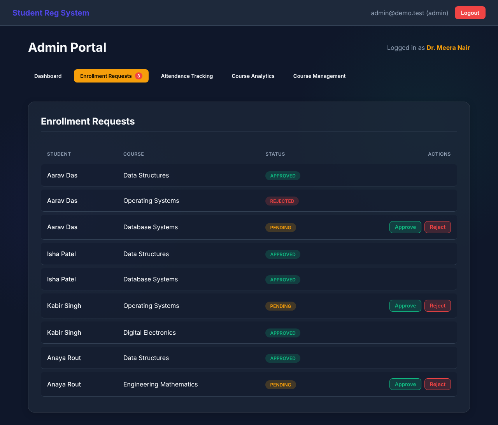
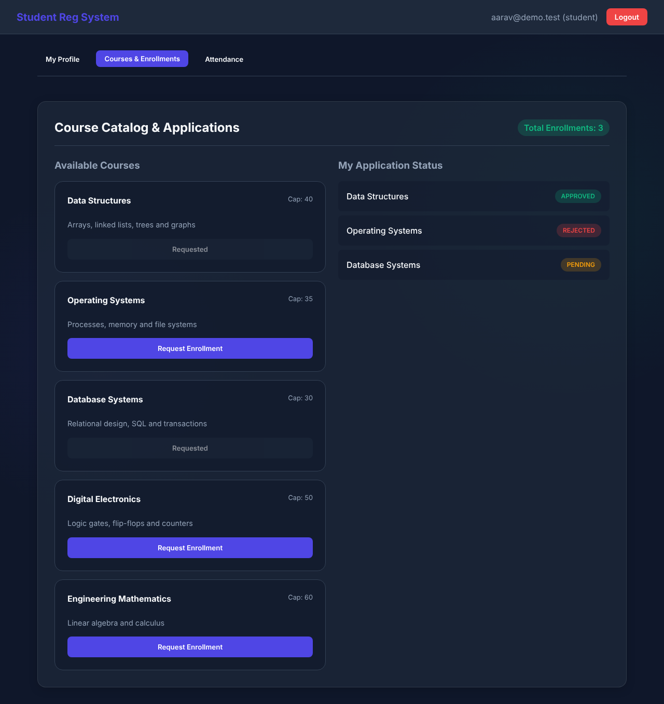
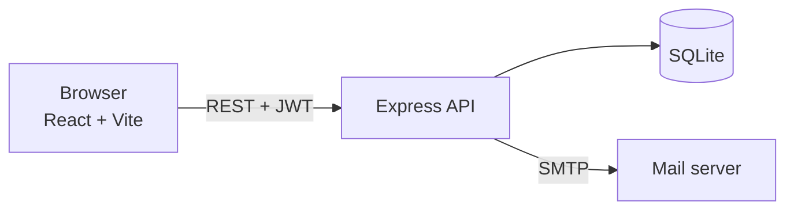

# OUTR Student Portal

[](https://github.com/Delusion-arch/outr-student-portal/actions/workflows/ci.yml)
[](LICENSE)

A web portal where students browse courses and request enrollment, and teachers approve requests, take attendance and look at course analytics.

I built it because enrollment at our college runs on paper forms and scattered messages, and nobody can see at a glance who is enrolled where or how many seats are left. This is my attempt at a simple version of that process, end to end: a React frontend, an Express API, and a SQLite database.

| Admin: enrollment requests | Student: course catalog |
|---|---|
|  |  |

The screenshots use made-up demo data.

## What it does

**Students**
- See their profile and the courses open to them (filtered by semester and branch)
- Request enrollment. The server checks that the course exists, has seats left and that they haven't already applied
- Follow the status of each request: pending, approved or rejected
- See their attendance per course
- Get an email when a request is received or decided

**Teachers (admins)**
- Create courses with a capacity, target semester and branches
- Approve or reject enrollment requests
- Mark attendance for each class date
- See analytics per course

## How it fits together



- The frontend is a single-page React app. It talks to the API with axios and sends a JWT in the `Authorization` header.
- The API is Express 5. Passwords are hashed with bcrypt, tokens are signed with `JWT_SECRET` and expire after 2 hours. Admin routes check the role in the token.
- Data lives in one SQLite file: users, courses, enrollments and attendance records.
- In Docker, the frontend is served by nginx and the database file sits on a volume.

### API at a glance

| Method | Path | Who | What |
|---|---|---|---|
| POST | `/api/register` | anyone | Create a student (admin needs an invite code) |
| POST | `/api/login` | anyone | Get a token |
| GET | `/api/profile` | logged in | Current user |
| GET | `/api/courses` | logged in | Courses (students see the ones that fit them) |
| POST | `/api/courses` | admin | Create a course |
| POST | `/api/enroll` | logged in | Request enrollment |
| GET | `/api/enrollments` | logged in | My requests |
| GET | `/api/enrollments/all` | admin | Every request |
| PUT | `/api/enrollments/:id` | admin | Approve or reject |
| POST | `/api/courses/:id/attendance` | admin | Save attendance for a date |
| GET | `/api/courses/:id/analytics` | admin | Course numbers |

## Run it with Docker

You need Docker with Compose.

```bash
git clone https://github.com/Delusion-arch/outr-student-portal.git
cd outr-student-portal
cp .env.example .env
# open .env and set JWT_SECRET (a long random string) and ADMIN_INVITE_CODE
docker compose up --build
```

Then open http://localhost:8080. The API runs on http://localhost:5000.

To create the first admin, go to `/register/admin` and enter the `ADMIN_INVITE_CODE` you chose.

## Run it without Docker

You need Node.js 20 or newer.

```bash
# API
cd backend
cp .env.example .env     # set JWT_SECRET and ADMIN_INVITE_CODE
npm install
npm start                # http://localhost:5000

# Frontend, in a second terminal
cd frontend
cp .env.example .env
npm install
npm run dev              # http://localhost:5173
```

### Settings

| Variable | Where | Meaning |
|---|---|---|
| `JWT_SECRET` | backend | Signs login tokens. Required, the server won't start without it |
| `ADMIN_INVITE_CODE` | backend | Code needed to register an admin. Empty switches admin sign-up off |
| `FRONTEND_URL` | backend | Address allowed to call the API (CORS) |
| `DB_PATH` | backend | Where the SQLite file lives |
| `SMTP_*`, `MAIL_FROM` | backend | Real mail server. Without `SMTP_HOST` it uses a test inbox and nothing is delivered |
| `VITE_API_URL` | frontend | API address, baked in at build time |

## Tests and CI

```bash
cd backend
npm test
```

18 API tests (Jest and Supertest) cover sign-up and login, who can reach which route, admin sign-up rules and the enrollment checks. They run against a temporary database, with email and the college ERP mocked.

On every push and pull request, GitHub Actions runs the tests, builds the frontend, builds both Docker images, and then starts the whole stack with Docker Compose to register and log in a student. Pushing a version tag publishes the images to GitHub Container Registry.

## What I learned

- Keeping settings out of the code. I started with a hard-coded secret and an open CORS policy and moved both to environment variables once I understood why that matters.
- Writing the API so it can be tested: exporting the Express app separately from `listen` made Supertest tests easy.
- That an unrestricted `role` field on sign-up lets anyone make themselves an admin. I found it while writing tests and closed it with an invite code.
- Packaging with Docker: multi-stage builds, a non-root user, and keeping the database on a volume.

## Roadmap

- [ ] Live demo link
- [ ] Rate limiting on login
- [ ] Move from SQLite to PostgreSQL for multi-user deployments
- [ ] Pagination on the larger tables

## License

MIT, see [LICENSE](LICENSE).
